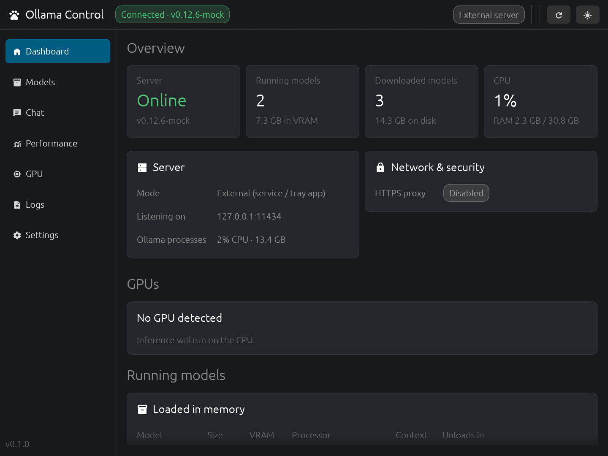
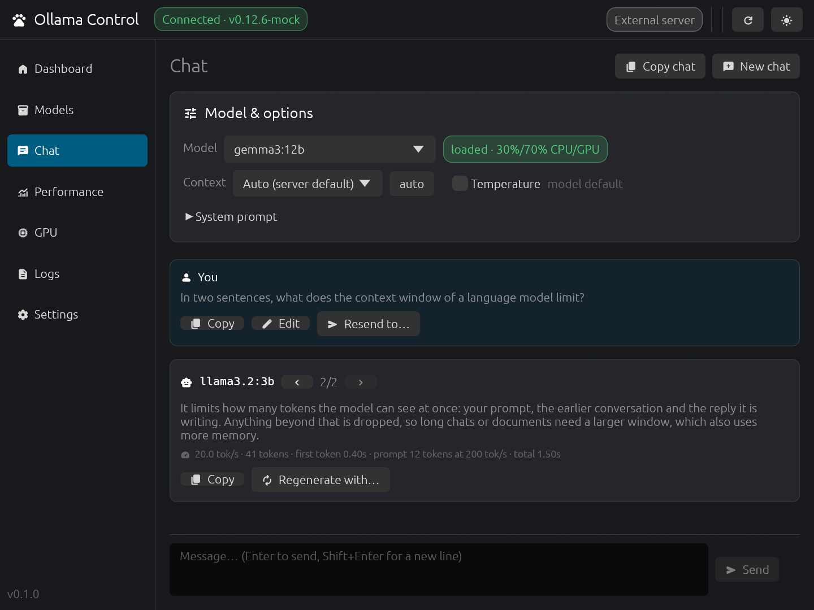
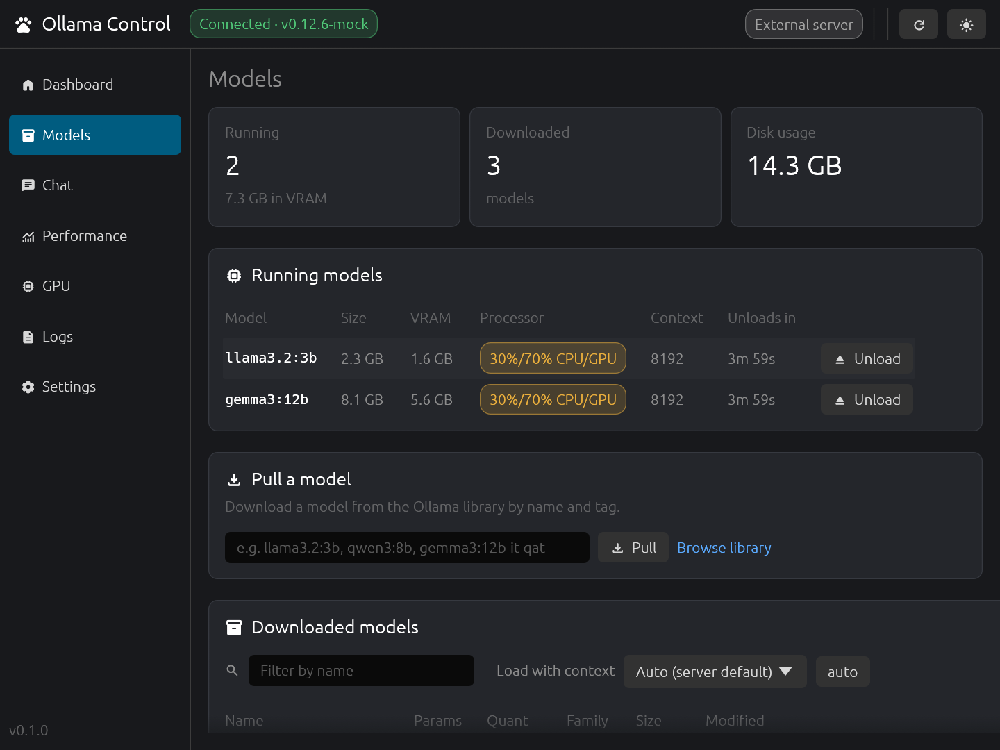
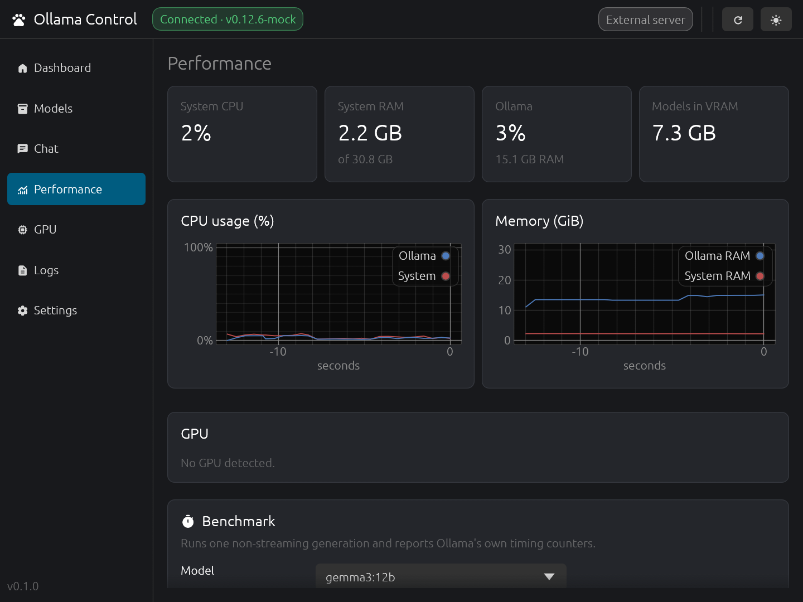
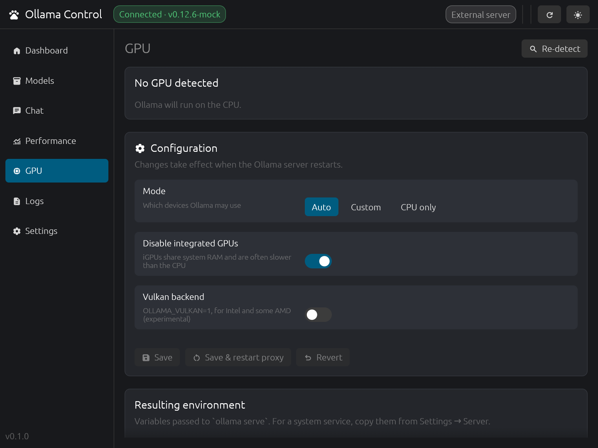
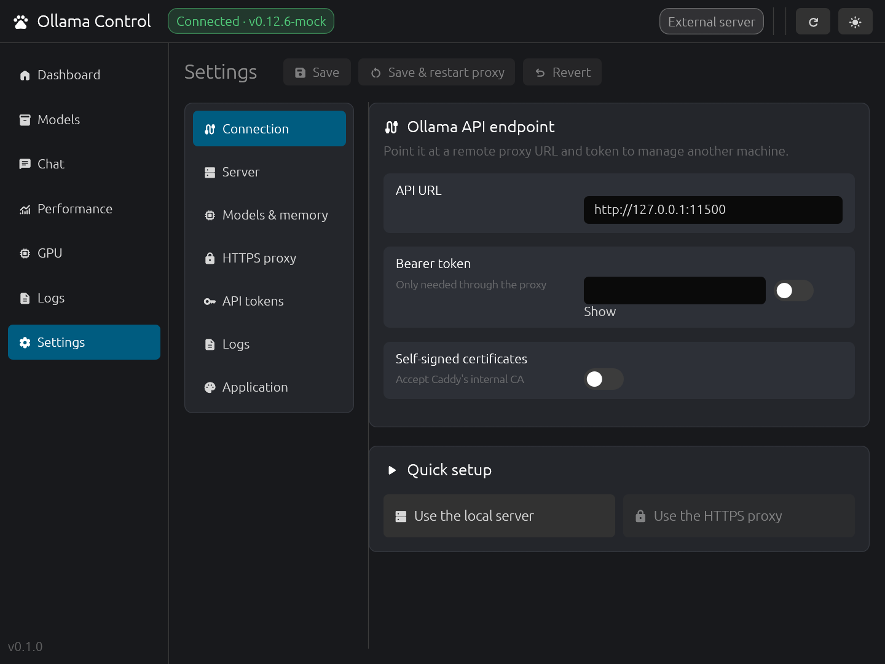

# Ollama Control

A cross-platform desktop control panel for [Ollama](https://ollama.com), written in Rust with [egui](https://github.com/emilk/egui). It runs on Linux, Windows and macOS.

> This is an independent, community project. It is not affiliated with or endorsed by Ollama.

## Features

| Tab | What it does |
|---|---|
| **Dashboard** | Server status and version, running models, GPU VRAM bars, CPU/RAM summary |
| **Models** | Running models (VRAM, CPU/GPU split, context, unload countdown), downloaded models (filter, load with a chosen context, unload, info, delete), pull with progress and cancel |
| **Chat** | Streamed chat with any downloaded model: model, context, temperature and system prompt; live and final tok/s, time to first token, thinking output. Each message can be copied, edited, resent, or regenerated with another model, and the answers are kept side by side (‹ ›) to compare speed and quality |
| **Performance** | Live charts for system and Ollama CPU, RAM, GPU utilisation and VRAM; a tokens/s benchmark that uses Ollama's own timing counters |
| **GPU** | Detects brand, model, type (discrete/integrated/unified), VRAM, usage and temperature. Modes: Auto / Custom (choose devices) / CPU only, an *integrated GPU* switch and a Vulkan toggle |
| **Logs** | Live log stream from the managed server, the official app's `server.log`, or `journalctl -u ollama`. Level filter, source filter, search, pause, copy, save |
| **Settings** | Panes: Connection (URL + bearer token) · Server (process, binding, paths, extra env, service snippet) · Models & memory (context length, keep-alive, parallelism, flash attention, KV cache) · HTTPS proxy · API tokens · Logs · Application (interface scale, theme, polling) |

### Screenshots

| | |
|---|---|
|  |  |
|  |  |
|  |  |

The screenshots are taken against the mock server in `tests/fixtures`. To regenerate them after a UI change, run `scripts/screenshots.sh` (debug builds only; see [CONTRIBUTING.md](CONTRIBUTING.md)).

### Two ways to run the server

* **External** (default): the app monitors an Ollama that is already running (tray app, systemd service, or a remote machine). Settings → Server → *Apply to a system-installed Ollama* produces the matching `systemctl edit` / `launchctl setenv` / PowerShell snippet.
* **Managed**: the app runs `ollama serve` itself with the environment built from your settings, and captures its logs. If it crashes, the app restarts it (up to 3 times a minute, then it stops and asks you to check the logs). Quit the official tray app or stop the service first so the port is free.

### HTTPS + API tokens (Caddy)

Ollama has no authentication. When the proxy is enabled:

1. Ollama is forced to bind to `127.0.0.1`.
2. A Caddyfile is generated (`<config dir>/Caddyfile`, mode 0600) that
   * terminates TLS: Caddy internal CA (self-signed), Let's Encrypt, your own cert/key, or plain HTTP,
   * rejects any request without `Authorization: Bearer <one of your tokens>` (401),
   * strips the token and reverse-proxies to Ollama, with `flush_interval -1` so streamed tokens arrive immediately,
   * optionally answers CORS preflights.
3. `caddy run` is supervised by the app, and its logs appear in the Logs tab.

You can create, label, copy, regenerate and revoke tokens from Settings. *Test proxy* calls `/api/version` through the proxy.
[Install Caddy](https://caddyserver.com/download) and make sure it is in `PATH`, or set its path in Settings.

### How GPU selection maps to Ollama

| Setting | Environment |
|---|---|
| CPU only | `CUDA_VISIBLE_DEVICES=-1`, `ROCR_VISIBLE_DEVICES=-1`, `HIP_VISIBLE_DEVICES=-1`, `GGML_VK_VISIBLE_DEVICES=-1` |
| NVIDIA device subset | `CUDA_VISIBLE_DEVICES=<GPU UUIDs>` |
| AMD device subset / iGPU off | `ROCR_VISIBLE_DEVICES=<indices>` |
| Vulkan (Intel, some AMD) | `OLLAMA_VULKAN=1`, `GGML_VK_VISIBLE_DEVICES=<indices>` |

Detection sources: `nvidia-smi` (all OSes, including WSL), `/sys/class/drm` + `lspci` (AMD/Intel on Linux), the display-adapter registry keys (Windows) and `system_profiler` (macOS). Live utilisation and temperature are available for NVIDIA and for AMD on Linux.

## Build

```sh
cargo run --release
```

Linux needs the usual desktop libraries (`libxkbcommon`, plus `libxkbcommon-x11` for X11, Wayland or X11, and GL/Vulkan drivers).

### Release packages (x86_64 and arm64)

```sh
./scripts/build.sh                 # Linux host: linux-x64 + linux-arm64 · macOS host: both archs + universal .app
./scripts/build.sh linux-arm64 windows-x64
./scripts/build.sh all --no-package
```

```powershell
.\scripts\build.ps1                # Windows 11: windows-x64 + windows-arm64
.\scripts\build.ps1 windows-arm64
```

Targets: `linux-x64`, `linux-arm64`, `linux-musl-x64`, `linux-musl-arm64`, `macos-x64`, `macos-arm64`, `windows-x64`, `windows-arm64` (or the groups `linux`, `macos`, `windows`, `all`, or full Rust triples). Archives go to `dist/`. A target the current machine can't build is skipped, with the reason shown.

| Target | Native host | Cross-compiling needs |
|---|---|---|
| Linux x64 / arm64 | Linux of that arch | `cargo-zigbuild` + zig (`pip install ziglang`) or `cross` + Docker. Binaries target glibc 2.31 |
| Linux musl x64 / arm64 | Alpine (or `rust:alpine` in Docker) of that arch | not supported; the release workflow builds them. Linked dynamically against musl, so they need musl's loader and the desktop libraries (e.g. Alpine) |
| macOS x64 / arm64 | macOS (Xcode CLT) | not possible from Linux/Windows; use a Mac or the release workflow |
| Windows x64 | Windows + VS 2022 Build Tools (C++) | `cargo-xwin` from Linux/macOS (downloads the MSVC SDK) |
| Windows arm64 | Windows + VS "MSVC ARM64 build tools" + LLVM clang (`winget install LLVM.LLVM`) | `cargo-xwin` |

Settings are saved in the platform config directory (`~/.config/ollama-egui/settings.toml` on Linux, `%APPDATA%\ollama-egui\config` on Windows, `~/Library/Application Support/ollama-egui` on macOS). The file holds your API tokens and is created with owner-only permissions on Unix.

## Notes

* **WSLg**: the WSLg Wayland compositor sometimes drops eframe windows ("Connection reset by peer"). This also happens with a minimal egui hello-world. Running natively on Windows avoids it.
* The app talks to the Ollama REST API (`/api/version`, `/api/tags`, `/api/ps`, `/api/show`, `/api/pull`, `/api/generate`, `/api/chat`, `/api/delete`), so it works with any recent Ollama version.

## Tests

```sh
cargo test                       # unit tests
cargo test e2e -- --ignored      # end-to-end: needs python3 and caddy (or CADDY=/path/to/caddy)
```

* Unit tests: Caddyfile generation (token matcher, TLS modes, CORS preflight, deny-all with no tokens), settings → environment variables, GPU selection, the process supervisor (env, log capture, crash detection, stop), and the `nvidia-smi` / Windows / macOS GPU parsers using sample output.
* End-to-end: starts a mock Ollama (`tests/fixtures/mock_ollama.py`) through the process supervisor and the real Caddy with a generated Caddyfile, then checks loopback binding, the 401 on a wrong token, streamed pulls through HTTPS, load/unload/delete, log capture and cleanup.

## CI and releases

`.github/workflows/ci.yml` runs fmt, clippy (`-D warnings`) and the tests on Linux, Windows and macOS. This includes the real GPU probes on each OS and the end-to-end test on Linux.
Pushing a `v*` tag runs `.github/workflows/release.yml`. It calls the same build scripts on native runners (Linux x64/arm64 glibc and musl, macOS universal, Windows x64/arm64) and attaches the archives to a draft GitHub release.

TLS for the client is behind the default `rustls` feature. `--no-default-features` builds without it, which is handy for cross-target `cargo check` without a C toolchain.

## Contributing

See [CONTRIBUTING.md](CONTRIBUTING.md).

## License

MIT, the same license as [Ollama](https://github.com/ollama/ollama/blob/main/LICENSE). See [LICENSE](LICENSE).
